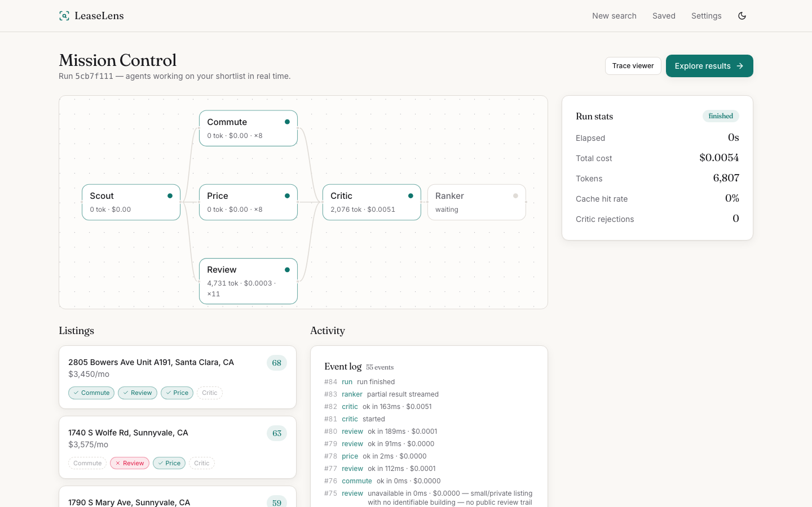
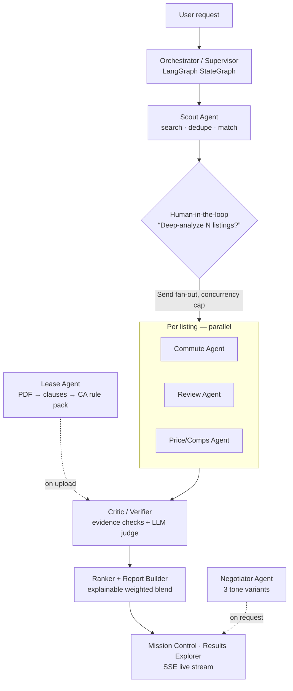
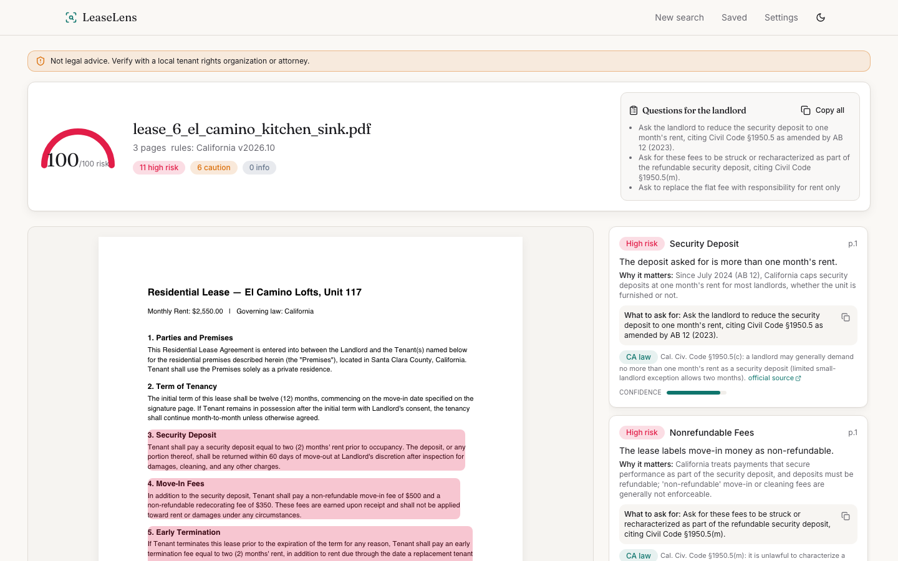
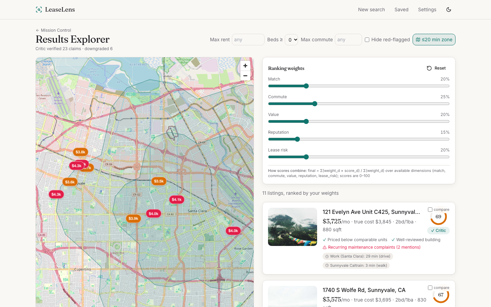
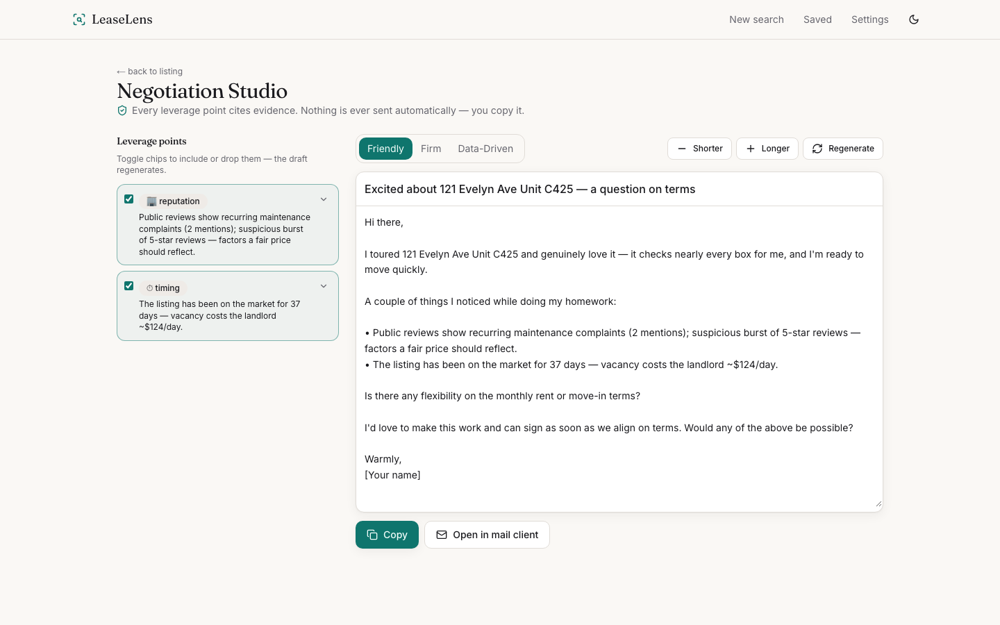

# LeaseLens

> Your apartment hunt, handled by a team of AI agents.

LeaseLens is a multi-agent system (**LangGraph + FastAPI + Next.js**) that scouts
listings, scores commutes, mines reviews for building red flags, analyzes lease
PDFs clause-by-clause with exact citations, benchmarks price against comps, and
drafts an evidence-backed negotiation email — with a **Critic agent** that
verifies every claim against its evidence before it reaches you.



## Quickstart — zero API keys

```bash
git clone https://github.com/Chirag-Hegde/leaselens && cd leaselens
make demo     # installs deps, seeds data, precomputes a run, starts api (:8000) + web (:3000)
```

Demo mode runs **fully offline**: deterministic mock LLM + data providers,
SQLite, in-memory cache. A full run on demo data finishes in **under 5 seconds**
with the live streaming UI. The offline dataset covers five Bay Area cities;
set `RENTCAST_API_KEY` in `backend/.env` (rentcast.io, free tier) for **live
US-wide listing search**. Listing photos are shown only when the listing
source provides them — never stock placeholders. Set `LLM_PROVIDER=anthropic`
and `ANTHROPIC_API_KEY` in `backend/.env` for real model calls (model routing:
`claude-haiku-5-5` for extraction/classification, `claude-opus-5-5` for lease
risk reasoning, negotiation writing, and critic judging — see
`backend/config/models.yaml`).

Measured against the live Anthropic API (same seeded data): a full search run
completes in **~24 s for ~$0.012** (12 Haiku theme labels + 2 Opus critic
judgments), a 3-page problem lease analyzes in **~2.5 min for ~$0.20**
(20 Haiku clause classifications + 17 Opus risk assessments), and three
negotiation tone drafts take **~29 s**. Structured outputs are used where the
schema fits; larger schemas (e.g. the search brief) automatically fall back
to schema-in-prompt generation with client-side validation.

## Tech stack

| Layer | Technology |
|---|---|
| Orchestration | LangGraph `StateGraph` (checkpointed, `Send` fan-out, `interrupt()` human-in-the-loop) |
| Backend | Python 3.12 · FastAPI · Pydantic v2 · SQLAlchemy 2.0 (async) · SSE |
| LLMs | Anthropic API (`claude-haiku-5-5` fast tier / `claude-opus-5-5` strong tier) + deterministic mock provider |
| Storage | SQLite (demo) / PostgreSQL 16 + pgvector (prod) · Redis + arq (prod jobs/cache) |
| PDF | PyMuPDF (layout-aware extraction with page + bounding boxes) |
| Observability | OpenTelemetry spans · optional Langfuse · `llm_calls` audit table |
| Frontend | Next.js 14 App Router · TypeScript strict · Tailwind + shadcn-style UI |
| Frontend data/viz | TanStack Query · Zustand · MapLibre GL · react-pdf · Recharts · React Flow · Framer Motion |
| Quality | pytest (53 tests, 83% cov) · mypy --strict · ruff · vitest · Playwright · eval suite with CI regression gate |

## Architecture overview



```
web (Next.js 14, App Router)          backend (FastAPI)
┌──────────────────────────┐          ┌────────────────────────────────────┐
│ Mission Control  (SSE)   │◀─events──│ EventBus → run_events + live queues│
│ Results Explorer (map)   │──REST───▶│ routes_* (briefs/runs/listings/    │
│ Lease Analyzer (react-pdf│          │   leases/negotiations/compare/...) │
│ Negotiation Studio       │          │ LangGraph supervisor (runner)      │
│ Trace Viewer             │          │   scout → plan ⇢ Send fan-out      │
└──────────────────────────┘          │   → critic → ranker                │
                                      │ providers (real + mock behind      │
                                      │   interfaces): llm/listings/geo/   │
                                      │   commute/reviews/embeddings       │
                                      │ services: budget, cache, events,   │
                                      │   llm routing, pdf, auth, redact   │
                                      └────────────────────────────────────┘
          SQLite (demo) / Postgres16+pgvector (prod) · Redis optional
```

## Architecture in detail

### Life of a run, end to end

1. **Brief** — `POST /api/briefs` accepts either a structured form or natural
   language. Free text goes through the `brief_parse` task (fast model) into a
   validated `SearchBriefInput`; important places ("Work", "Gym") are geocoded.
2. **Launch** — `POST /api/runs` creates the Run row plus a `RunContext`
   (budget tracker, provider handles, event-bus handle, listing cache) and
   launches the LangGraph graph as a background task, checkpointed under
   `thread_id = run_id`.
3. **Scout** — queries the listings provider, **dedupes across sources**
   (normalized address match, or <30 m geodistance with same beds and rent
   within 3%), hard-filters deal-breakers, scores each match 0–100 with a
   human-readable explanation, and suggests constraint relaxations when few
   results survive. If no source covers the requested cities it returns a
   typed `unavailable` result saying exactly that — never an empty lie.
4. **Plan (human-in-the-loop)** — if more than N listings qualify, the graph
   calls LangGraph's `interrupt()` with a typed question (“Scout found 11
   matches. Deep-analyze all of them? est. $0.13”). The run checkpoint parks;
   `POST /api/runs/{id}/resume` continues with the user's cap via
   `Command(resume=...)`. Because state is checkpointed, this survives API
   restarts.
5. **Fan-out** — each selected listing becomes a LangGraph `Send` task running
   the per-listing agents (Commute, Review, Price) concurrently, with a global
   concurrency cap. Results merge back through a custom reducer keyed by
   listing id.
6. **Critic** — collects every quantitative claim and red flag produced so
   far, **recomputes the math deterministically** (price percentiles, commute
   scores vs. the brief's own tolerances) and runs an LLM judge over
   evidence-backed claims with a strict rubric. Unsupported claims are removed
   from the results (and logged); listings whose claims all pass get the
   verified badge.
7. **Rank & report** — dimension scores blend as `final = Σ(w·s)/Σ(w)` over
   *available* dimensions only (a listing with no review data isn't silently
   penalized). The formula and weights ship to the client, so moving a weight
   slider re-ranks instantly with zero API calls. Isochrone bands for the
   primary place are attached for the map overlay.
8. **Stream** — every step above publishes typed events; the UI renders them
   live as the agent graph, listing badges, token/cost counters, and the
   final report.

### The agent team

Every agent returns the same envelope and plays by the same rules: **never
invent data** — a source that's down or unconfigured yields a typed
`unavailable` result with a reason, which the UI shows honestly.

| Agent | Model tier | Key logic |
|---|---|---|
| **Scout** | fast (extraction only) | provider search → cross-source dedupe → deal-breaker hard filter → match scoring with explanations → relax suggestions |
| **Commute** | none (computed) | peak/off-peak per mode, geohash-pair cache, nonlinear over-tolerance penalty (`100−25(t/tol)²`, then `75e^(−1.4Δ/tol)`), isochrones |
| **Review** | fast (theme labels) | embed → greedy cosine clustering → one label call per cluster (fixed 8-theme taxonomy) → recency trends → fake-burst detection (≥4 near-5★ reviews in 14 days) → management score + red flags |
| **Price** | none (computed) | comps = same beds, ≤1.5 mi, ≤60 days, sqft ±20% → percentile, p25–p75 fair range, $/sqft, true monthly cost (rent + recurring fees + estimated utilities) |
| **Lease** | fast classify + strong risk | PDF → layout-aware extraction (page + bbox) → clause segmentation → 21-type taxonomy → CA rule-pack grounding → exact-span citations → risk 0–100 + questions checklist |
| **Negotiator** | strong | evidence-linked leverage points (deterministic ids), asks (rent/fees/parking/redlines), 3 tones × 3 lengths; never sends email — copy only |
| **Critic** | strong (judge) | deterministic recomputation + evidence hygiene + strict judge rubric; rejected claims removed & logged; verified badges |
| **Ranker** | none | explainable weighted blend; client re-ranks instantly |

### Typed contracts everywhere

No untyped dict ever crosses an agent boundary. The core envelope
(`backend/app/agents/contracts.py`):

```python
class AgentResult[T](BaseModel):          # PEP 695 generics, mypy --strict
    agent: str
    status: Literal["ok", "partial", "unavailable", "error"]
    data: T | None
    evidence: list[Evidence]              # source_type, url, excerpt, retrieved_at
    confidence: float
    tokens_in: int; tokens_out: int; cost_usd: float; latency_ms: int
    reason: str | None                    # validator: required when status != ok
```

`run_agent()` wraps every agent call: it binds a `ContextVar` usage
accumulator (so each envelope carries exactly the tokens/cost *it* spent, even
under concurrent fan-out), emits `agent_started`/`agent_finished` events, and
converts timeouts, budget stops, and exceptions into typed `error`/`partial`
results instead of crashing the run. The frontend mirrors all contracts in
TypeScript.

### Graph state vs. RunContext

LangGraph state must be checkpoint-serializable, so it holds only JSON
(envelope dumps, selected ids, the report). Everything non-serializable —
provider clients, the budget tracker, the event bus, the listing cache —
lives in a per-run `RunContext` registry keyed by `run_id`, looked up inside
each node. This split is what makes checkpoint/resume work.

### Events & streaming

`EventBus.publish` assigns a per-run sequence number, **redacts PII**
(emails/phones/SSNs) from payloads, persists to the `run_events` table, and
fans out to per-subscriber asyncio queues. The SSE endpoint
(`GET /api/runs/{id}/events`) replays history from `?after=seq`, then
live-tails with keepalives; the client dedupes by sequence on reconnect.
Terminal events close the stream. The same event log powers the Trace Viewer
and replays of finished runs.

### Providers: mock-first, real behind the same interface

Every external dependency sits behind a small interface with a deterministic
mock, so `make demo` needs zero keys and CI is fully hermetic:

| Provider | Real implementation | Mock behavior |
|---|---|---|
| LLM | Anthropic structured outputs (+ schema-in-prompt fallback for schemas that exceed the complexity limit) | per-task handlers returning schema-valid deterministic output |
| Listings | RentCast official API (US-wide, activated by key) | 150 seeded listings across 5 Bay Area cities |
| Geocoding | Nominatim | deterministic hash-jittered coordinates |
| Commutes | OpenRouteService | speed-model travel times + circular isochrones |
| Reviews | Google Places + Reddit OAuth | 53 seeded review/post fixtures incl. planted red flags |
| Embeddings | provider API | seeded random projection (stable per text) |

Adding a real key flips one provider at a time — agent code never changes.
Hybrid modes are first-class: e.g. mock data + real Anthropic LLM.

### Model routing & cost control

`backend/config/models.yaml` maps each task to a tier: cheap/fast
(`claude-haiku-5-5`) for brief parsing, listing extraction, clause
classification, and review theme labels; strong (`claude-opus-5-5`) for clause
risk reasoning, negotiation drafting, and critic judging. Every call records
model, prompt version, tokens, cost, and latency to the `llm_calls` table and
an OTel span. A per-run `BudgetTracker` (default $0.50 / 200k tokens) stops
agents gracefully — they return `partial` results instead of blowing the cap.
Prompts live in `backend/app/prompts/*.md` with version headers; untrusted
content (listings, reviews, lease text) is delimited with explicit
ignore-instructions rules.

### The showcase: Lease Analyzer



PDF → layout-aware extraction (page + bounding boxes) → clause segmentation →
classification against a 21-type taxonomy (fast model) → risk reasoning
(strong model) grounded in a **versioned California rule pack**
(`backend/app/rules/california.yaml`): deposit cap (AB 12), 21-day return,
non-refundable fee ban, AB 1482 rent caps, §1954 entry notice, §1953
jury/liability waivers, §1717 fee reciprocity — every rule cites an official
`leginfo.legislature.ca.gov` source. Rules without a verified source are
labeled *“worth asking about”*, never “illegal”. Findings map back to the
exact highlighted span in the PDF, both panes stay in sync, and every finding
ships a copyable redline.

**Not legal advice. Verify with a local tenant rights organization or attorney.**

### Data model

17 tables (`backend/app/db/models.py`): relational columns for everything
queryable (rent, beds, geo, severity, status) plus JSON payload columns
holding validated contract dumps. Portable custom types keep one schema across
both databases: `PortableJSON` (JSONB on Postgres, JSON on SQLite) and
`EmbeddingVector` (pgvector `vector(1536)` on Postgres, JSON text on SQLite,
similarity computed in NumPy at demo scale). Alembic handles migrations.

## Why multi-agent? (eval results)

`make evals` runs the suite (`python -m evals.run --suite all`) and writes
`evals/reports/report.{md,json}`. Demo-mode numbers are deterministic (mock
providers) — honest caveats included:

| Metric | Multi-agent | Single-agent baseline¹ |
|---|---|---|
| NDCG@5 vs oracle labels (10 personas) | 0.603 | **0.613** |
| Red-flag recall (known problem buildings in top-5) | **1.00** | 0.00 |
| Lease clause detection micro-F1 (6 labeled leases) | **1.00²** | n/a |
| Citation accuracy (page + bbox overlap ≥ 0.5) | **0.93** | n/a |
| Critic catch rate (20 injected unsupported claims) | **100%** (0 false positives) | n/a |
| Run latency p50 / p95 | 0.43s / 0.56s | — |
| Run cost p50 (mock pricing) | $0.0022 | — |

¹ Scout match score only — one monolithic pass, no specialists, no critic.
² On the deterministic demo dataset; re-run with real models for production
figures. The honest headline: **pure ranking is a wash** (the oracle doesn't
reward what specialists know), but the specialists surface red flags, lease
risks, and verified evidence a single agent structurally cannot — and the
**CI gate fails if lease F1 drops more than 5 points** from baseline.

## More screens

| | |
|---|---|
|  |  |
| Results Explorer — map, isochrone overlay, instant re-rank sliders | Negotiation Studio — evidence-linked leverage chips, 3 tones |

## Project structure

```
leaselens/
├── backend/
│   ├── app/
│   │   ├── agents/        # scout, commute, review, price, lease, negotiator,
│   │   │                  #   critic, ranker + contracts.py (all Pydantic models)
│   │   ├── api/           # FastAPI routers (briefs, runs, listings, leases, …)
│   │   ├── graph/         # build_graph.py (LangGraph), runner, RunContext, state
│   │   ├── providers/     # llm / listings / geocode / commute / reviews /
│   │   │                  #   embeddings — each: base.py + real + mock + factory
│   │   ├── prompts/       # versioned prompt markdown per task
│   │   ├── rules/         # california.yaml rule pack (versioned, cited)
│   │   ├── seed/          # demo listings/reviews/leases + precomputed run
│   │   ├── services/      # llm routing, budget, events, pdf, auth, redact, …
│   │   ├── db/            # SQLAlchemy models, portable types, Alembic
│   │   └── telemetry/     # OTel + Langfuse exporters
│   ├── evals/             # eval suites + CI regression gate + baselines
│   └── tests/             # 53 hermetic tests (mock-only, isolated SQLite)
├── web/
│   ├── app/               # routes: landing, /new, /runs/[id] (+results/trace),
│   │   │                  #   /listings/[id], /leases, /compare, /saved, /settings
│   ├── components/        # landing, run (mission control), results, lease, ui
│   └── lib/               # typed api client, ranking math, hooks, stores
├── docs/                  # architecture, agent specs, ADRs 001–004, deploy
├── docker-compose.yml     # api + worker + web + Postgres/pgvector + Redis + Langfuse
└── Makefile               # demo / dev / test / lint / typecheck / evals
```

## Development

```bash
make setup       # backend (uv) + web (npm)
make dev         # api + web with reload
make test        # pytest (53 tests, 83% coverage) + vitest
make test-e2e    # Playwright full-journey test
make lint        # ruff + eslint + prettier
make typecheck   # mypy --strict + tsc --strict
make evals       # eval suite + reports
```

Docker: `docker compose up` brings up api, worker (arq), web, Postgres 16 +
pgvector, Redis, and Langfuse. Locally, demo mode needs none of them
([ADR-001](docs/decisions/ADR-001-sqlite-fallback-for-demo.md)).

**Lighthouse** (production build, default mobile emulation):
landing **96 / 100** (performance / accessibility), results explorer
**92 / 100**. The results page server-renders run data (zero CLS), lazy-mounts
MapLibre when its container nears the viewport (0 ms total blocking time),
and ships CSS-only hero animations.

### Configuration

All config is environment-driven (see [.env.example](.env.example)); put
overrides in `backend/.env` (gitignored).

| Variable | Default | Effect |
|---|---|---|
| `DEMO_MODE` | `true` | offline defaults: SQLite, in-memory cache, mock providers |
| `LLM_PROVIDER` | `mock` | `anthropic` switches to real models (needs `ANTHROPIC_API_KEY`) |
| `RENTCAST_API_KEY` | unset | activates live US-wide listing search (even in demo mode) |
| `RUN_BUDGET_USD` / `RUN_BUDGET_TOKENS` | `0.50` / `200000` | per-run hard budget |
| `FANOUT_CONCURRENCY` | `5` | max listings analyzed concurrently |
| `DATABASE_URL` / `REDIS_URL` | unset | point at Postgres/Redis for production |

## Design decisions

- [ADR-001 — SQLite/in-memory fallbacks for a zero-dependency demo](docs/decisions/ADR-001-sqlite-fallback-for-demo.md)
- [ADR-002 — Why LangGraph (and how the graph is shaped)](docs/decisions/ADR-002-why-langgraph.md)
- [ADR-003 — Why a Critic agent](docs/decisions/ADR-003-critic-agent.md)
- [ADR-004 — Typed contracts & cost controls](docs/decisions/ADR-004-typed-contracts-and-cost.md)
- [Architecture deep-dive](docs/architecture.md) · [Agent specs](docs/agents.md) · [Deploying](docs/deploy.md)

## Security & privacy

Lease PDFs are user-deletable and auto-purged after 30 days; uploads are
validated (MIME, magic bytes, ≤20MB, ≤100 pages). Scraped/review/listing text
is treated as **untrusted input** (delimited in prompts with
ignore-instructions rules). PII (emails, phones, SSNs) is redacted from
streamed events and traces; `llm_calls` stores metadata only, never prompt
text. API keys live only in `backend/.env` and are never rendered in the UI
(Settings shows presence booleans only). API requests are rate-limited per
client.

## Limitations & ethics

- **Not legal advice** — the Lease agent cites official sources and marks
  unverified rules explicitly, but a tenant-rights org or attorney should
  verify anything that matters.
- **ToS-respecting data**: official APIs (RentCast, Google Places, Reddit
  OAuth, OpenRouteService, Nominatim) and user-pasted content only; no
  scraping of sites that prohibit it. Review excerpts are short and always
  link to their source.
- Demo-mode eval numbers are deterministic by construction; treat them as a
  harness demonstration, not model benchmarks.
