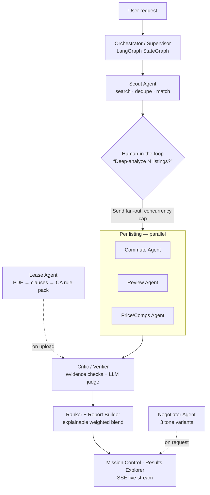

# LeaseLens

> Your apartment hunt, handled by a team of AI agents.

LeaseLens is a multi-agent system (**LangGraph + FastAPI + Next.js**) that scouts
listings, scores commutes, mines reviews for building red flags, analyzes lease
PDFs clause-by-clause with exact citations, benchmarks price against comps, and
drafts an evidence-backed negotiation email — with a **Critic agent** that
verifies every claim against its evidence before it reaches you.


## Quickstart — zero API keys

```bash
git clone <this repo> && cd leaselens
make demo     # installs deps, seeds data, precomputes a run, starts api (:8000) + web (:3000)
```

Demo mode runs **fully offline**: deterministic mock LLM + data providers,
SQLite, in-memory cache. A full run on demo data finishes in **under 5 seconds**
with the live streaming UI. Set `LLM_PROVIDER=anthropic` and
`ANTHROPIC_API_KEY` in `backend/.env` for real model calls (model routing:
`claude-haiku-5-5` for extraction/classification, `claude-opus-5-5` for lease
risk reasoning, negotiation writing, and critic judging — see
`backend/config/models.yaml`).

## Architecture



- **Typed contracts everywhere**: every agent returns `AgentResult[T]`
  (status, data, evidence list, confidence, tokens, cost, latency) — no
  untyped dicts cross agent boundaries. Unavailable sources return typed
  `unavailable` results with a reason; the UI shows them.
- **Checkpointed runs**: graph state persists (SQLite/Postgres), so runs
  resume across the human-in-the-loop interrupt and survive restarts.
- **Budgets**: every run has a token/dollar budget; agents degrade to partial
  results instead of blowing through it.
- **Observability**: every LLM call is logged (model, prompt version, tokens,
  cost, latency) to the `llm_calls` table, exported as OpenTelemetry spans
  (+ optional Langfuse), and rendered in the built-in
  [Trace Viewer](docs/screenshots/trace-viewer.png).

## Why multi-agent? (eval results)

`make evals` runs the suite (`python -m evals.run --suite all`) and writes
`evals/reports/report.{md,json}`. Demo-mode numbers are deterministic (mock
providers) — honest caveats included:

| Metric | Multi-agent | Single-agent baseline¹ |
|---|---|---|
| NDCG@5 vs oracle labels (10 personas) | 0.603 | **0.613** |
| Red-flag recall (known problem buildings in top-5) | **1.00** | 0.00 |
| Lease clause detection micro-F1 (6 labeled leases) | **1.00²** | n/a |
| Citation accuracy (page + bbox overlap ≥ 0.5) | **0.93** | n/a |
| Critic catch rate (20 injected unsupported claims) | **100%** (0 false positives) | n/a |
| Run latency p50 / p95 | 0.43s / 0.56s | — |
| Run cost p50 (mock pricing) | $0.0022 | — |

¹ Scout match score only — one monolithic pass, no specialists, no critic.
² On the deterministic demo dataset; re-run with real models for production
figures. The honest headline: **pure ranking is a wash** (the oracle doesn't
reward what specialists know), but the specialists surface red flags, lease
risks, and verified evidence a single agent structurally cannot — and the
**CI gate fails if lease F1 drops more than 5 points** from baseline.

## The showcase: Lease Analyzer


PDF → layout-aware extraction (page + bounding boxes) → clause segmentation →
classification against a 21-type taxonomy (fast model) → risk reasoning
(strong model) grounded in a **versioned California rule pack**
(`backend/app/rules/california.yaml`): deposit cap (AB 12), 21-day return,
non-refundable fee ban, AB 1482 rent caps, §1954 entry notice, §1953
jury/liability waivers, §1717 fee reciprocity — every rule cites an official
`leginfo.legislature.ca.gov` source. Rules without a verified source are
labeled *“worth asking about”*, never “illegal”. Findings map back to the
exact highlighted span in the PDF, both panes stay in sync, and every finding
ships a copyable redline.

**Not legal advice. Verify with a local tenant rights organization or attorney.**

## More screens

| | |
|---|---|
|  |  |
| Results Explorer — map, isochrone overlay, instant re-rank sliders | Negotiation Studio — evidence-linked leverage chips, 3 tones |

## Development

```bash
make setup       # backend (uv) + web (npm)
make dev         # api + web with reload
make test        # pytest (53 tests, 83% coverage) + vitest
make test-e2e    # Playwright full-journey test
make lint        # ruff + eslint + prettier
make typecheck   # mypy --strict + tsc --strict
make evals       # eval suite + reports
```

Docker: `docker compose up` brings up api, worker (arq), web, Postgres 16 +
pgvector, Redis, and Langfuse. Locally, demo mode needs none of them
([ADR-001](docs/decisions/ADR-001-sqlite-fallback-for-demo.md)).

## Design decisions

- [ADR-001 — SQLite/in-memory fallbacks for a zero-dependency demo](docs/decisions/ADR-001-sqlite-fallback-for-demo.md)
- [ADR-002 — Why LangGraph (and how the graph is shaped)](docs/decisions/ADR-002-why-langgraph.md)
- [ADR-003 — Why a Critic agent](docs/decisions/ADR-003-critic-agent.md)
- [ADR-004 — Typed contracts & cost controls](docs/decisions/ADR-004-typed-contracts-and-cost.md)
- [Architecture deep-dive](docs/architecture.md) · [Agent specs](docs/agents.md) · [Deploying](docs/deploy.md)

## Security & privacy

Lease PDFs are user-deletable and auto-purged after 30 days; uploads are
validated (MIME, magic bytes, ≤20MB, ≤100 pages). Scraped/review/listing text
is treated as **untrusted input** (delimited in prompts with
ignore-instructions rules). PII (emails, phones, SSNs) is redacted from
streamed events and traces; `llm_calls` stores metadata only, never prompt
text. API requests are rate-limited per client.

## Limitations & ethics

- **Not legal advice** — the Lease agent cites official sources and marks
  unverified rules explicitly, but a tenant-rights org or attorney should
  verify anything that matters.
- **ToS-respecting data**: official APIs (RentCast, Google Places, Reddit
  OAuth, OpenRouteService, Nominatim) and user-pasted content only; no
  scraping of sites that prohibit it. Review excerpts are short and always
  link to their source.
- Demo-mode eval numbers are deterministic by construction; treat them as a
  harness demonstration, not model benchmarks.
